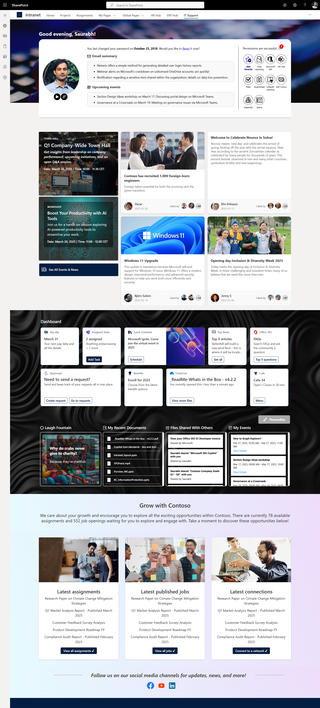

# sp-hack-030325

## Summary

An employee-centric intranet hub built with SharePoint Framework (SPFx), designed to deliver personalized, connected, and productive experiences across Microsoft 365 - including Teams, Outlook, and Office.

Key highlights:
- **Welcome Card**  
  - Greets users based on their time zone  
  - Displays user profile  
  - Provides AI-powered email and calendar summaries  
  - Shows password alerts  
  - Consolidated notification center with updates from SAP, Maconomy, IFS, and more  
  - Includes Quick Links for company-wide resources and personal shortcuts  
  - Features a Guided Tour and Feedback option for continuous improvement

- **Latest News and Events**  
  - Keeps employees informed about organizational happenings

- **Dashboard Area**  
  - Offers a common Viva Connections Dashboard  
  - Provides a highly customizable Personal Dashboard  
  - Allows employees to pick and arrange widgets suited to their role  
  - Integrates data from Microsoft Graph, SharePoint, public APIs, or APIs secured by Entra ID  
  - No code changes required for customization

- **SharePoint Agent**  
  - Intelligent assistant for finding and accessing important forms and processes (e.g., procurement, IT requests, travel, leave)

In action this looks like:

## Used SharePoint Framework Version

## Applies to

- [SharePoint Framework](https://aka.ms/spfx)
- [Microsoft 365 tenant](https://docs.microsoft.com/en-us/sharepoint/dev/spfx/set-up-your-developer-tenant)

> Get your own free development tenant by subscribing to [Microsoft 365 developer program](http://aka.ms/o365devprogram)

## Prerequisites

> Any special pre-requisites?

## Solution

| Solution    | Author(s)                                               |
| ----------- | ------------------------------------------------------- |
| folder name | Author details (name, company, twitter alias with link) |

## Version history

| Version | Date             | Comments        |
| ------- | ---------------- | --------------- |
| 1.1     | March 10, 2021   | Update comment  |
| 1.0     | January 29, 2021 | Initial release |

## Disclaimer

**THIS CODE IS PROVIDED _AS IS_ WITHOUT WARRANTY OF ANY KIND, EITHER EXPRESS OR IMPLIED, INCLUDING ANY IMPLIED WARRANTIES OF FITNESS FOR A PARTICULAR PURPOSE, MERCHANTABILITY, OR NON-INFRINGEMENT.**

---

## Minimal Path to Awesome

- Clone this repository
- Ensure that you are at the solution folder
- in the command-line run:
  - **npm install**
  - **gulp serve**

> Include any additional steps as needed.

## Features

Description of the extension that expands upon high-level summary above.

This extension illustrates the following concepts:

- topic 1
- topic 2
- topic 3

> Notice that better pictures and documentation will increase the sample usage and the value you are providing for others. Thanks for your submissions advance.

> Share your web part with others through Microsoft 365 Patterns and Practices program to get visibility and exposure. More details on the community, open-source projects and other activities from http://aka.ms/m365pnp.

## References

- [Getting started with SharePoint Framework](https://docs.microsoft.com/en-us/sharepoint/dev/spfx/set-up-your-developer-tenant)
- [Building for Microsoft teams](https://docs.microsoft.com/en-us/sharepoint/dev/spfx/build-for-teams-overview)
- [Use Microsoft Graph in your solution](https://docs.microsoft.com/en-us/sharepoint/dev/spfx/web-parts/get-started/using-microsoft-graph-apis)
- [Publish SharePoint Framework applications to the Marketplace](https://docs.microsoft.com/en-us/sharepoint/dev/spfx/publish-to-marketplace-overview)
- [Microsoft 365 Patterns and Practices](https://aka.ms/m365pnp) - Guidance, tooling, samples and open-source controls for your Microsoft 365 development
